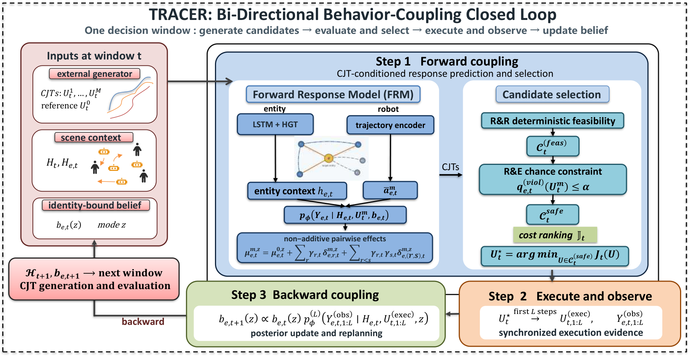

<p align="center"></p>

<h3 align="center">Adaptive Multi-Robot Social Navigation via Joint Human-Response Prediction and Interaction-Aware Replanning</h3>

<p align="center">
  <a href="docs/installation.md">Installation</a> ·
  <a href="docs/reproduction.md">Reproduction</a> ·
  <a href="results/README.md">Results</a> ·
  <a href="https://arxiv.org/abs/2609.18776">Paper (arXiv)</a> ·
  <a href="README.zh-CN.md">中文</a>
</p>

**TRACER evaluates joint robot plans through predicted human responses, executes a short prefix, and uses the observed response to adapt the next decision.** Its response model separates individual-robot effects from non-additive pairwise interactions. Identity-bound beliefs retain evidence across replanning windows.

## Method

<p align="center"></p>

| Stage | Implementation | Contract |
| --- | --- | --- |
| Predict | [`sage/response/models.py`](sage/response/models.py) | Condition each entity's response on candidate joint robot actions |
| Remember | [`sage/belief/`](sage/belief) · [`persistent_models.py`](sage/response/persistent_models.py) | Bind response-mode evidence to entity identity |
| Select and execute | [`sage/response/closed_loop.py`](sage/response/closed_loop.py) | Rank feasible candidates and execute a synchronized prefix |
| Update and replan | [`sage/experiments/`](sage/experiments) | Update from executed interactions and observed responses |

## Quick start

Use Python 3.10 or newer; the local core regression environment uses Python 3.12. After [installation](docs/installation.md), run from this repository root:

```bash
python -m pytest tests/test_response_experiment.py tests/test_belief_experiment.py tests/test_closed_loop_correctness.py -q
```

These three test files cover response learning, belief updates and closed-loop correctness. The repository also retains broader tests, some of which require external simulators or archived experiment assets. The core suite is the default CI check.

For a small data-free training run on robot-caused synthetic responses:

```bash
python -m sage.experiments.train_response_baselines --config configs/quickstart.yaml --device cpu --epochs 1 --limit-train-batches 1 --limit-val-batches 1 --variants joint --output-dir experiments/quickstart
```

This example verifies the training path. The formal evaluation uses separate protocol configurations and multiple seeds.

## Research evidence

| Question | Manuscript evidence | Scope |
| --- | --- | --- |
| Do joint robot effects matter? | Pair-effect RMSE decreases **23.94%** against the capacity-matched additive predictor | Controlled factorial response experiments |
| Does identity-consistent memory help? | Persistent beliefs improve prediction under ID and OOD settings | Within-model identity and memory ablations |
| Does the closed loop help navigation? | SocialGym2 collision-free completion: **22.5% → 31.6%** against GoAlone | 320 paired episodes, binary GoAlone/Halt execution adapter |

The manuscript's SocialGym2 comparison evaluates TRACER against GoAlone; its reported completion rate does not establish that every component ablation is worse. Controlled ungated replanning, conditional safety-gate attribution, development scenes and later external checks have separate interpretations. See [the result index](results/README.md).

## Reproduce and inspect

| Entry | Contents |
| --- | --- |
| [Reproduction](docs/reproduction.md) | Core commands, formal configs and evaluation requirements |
| [Result index](results/README.md) | 14 selected CSVs, manuscript tables and evidence boundaries |
| [Assets](docs/assets.md) | External simulator inventory and missing training artifacts |
| [Paper on arXiv](https://arxiv.org/abs/2609.18776) | Public preprint and version history |

```text
sage/response/  Joint-action response models, candidate selection and execution
sage/belief/    Persistent entity beliefs and filtering
configs/       Formal protocols and labeled development configurations
tests/         Core regressions and extended research checks
results/       Selected tables and paired statistics
docs/          Setup, reproduction, assets and architecture
```

Dataset sources, simulator requirements and model availability are listed in the [asset guide](docs/assets.md).

## Citation

If you use TRACER in your research, please cite the [paper](https://arxiv.org/abs/2609.18776). Citation details: [BibTeX](docs/citation.bib) · [CITATION.cff](CITATION.cff).
