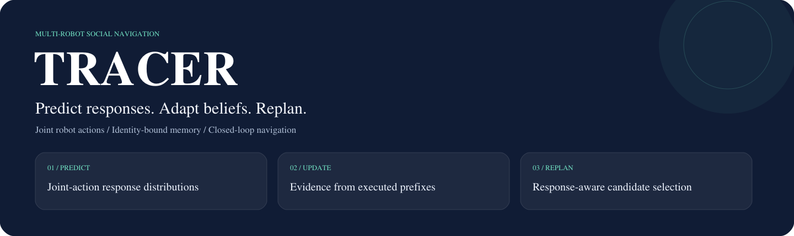

# TRACER

**TRACER 用联合机器人动作预测周围实体的响应，执行短时计划后，将实际观察用于更新身份绑定的持续信念，再进行下一轮规划。** 响应模型区分单机器人效应和机器人对之间的非加性交互。



[English](README.md) · [安装](docs/installation.md) · [复现实验](docs/reproduction.md) · [结果索引](results/README.md) · [论文版本](paper/README.md)

## 开始运行

使用 Python 3.10 以上版本，按[安装说明](docs/installation.md)建立独立环境，然后运行：

```bash
python -m pytest tests/test_response_experiment.py tests/test_belief_experiment.py tests/test_closed_loop_correctness.py -q
```

三组核心测试覆盖响应预测、信念更新和闭环正确性。扩展测试可能需要外部模拟器或历史实验资产，不能把核心测试通过等同于全部实验复现。

## 结果与论文

- 配对交互 RMSE 相对容量匹配的加性预测器下降 23.94%。
- 持续信念的实验比较同一模型内的记忆和身份机制。
- SocialGym2 的 320 个配对回合中，相对 GoAlone，无碰撞完成率从 22.5% 提高至 31.6%；该实验使用 GoAlone/Halt 二元执行适配器。
- 匿名投稿稿为 8 页，带作者预印本为 9 页，分别保存在 `paper/submission/` 和 `paper/arxiv/`。

[14 份精选结果 CSV](results/README.md)和论文内嵌表分别标记证据范围。数据、权重和外部模拟器见[资产说明](docs/assets.md)。内部沿用 `sage` 包名，需与 SAGE 分别使用独立环境。
