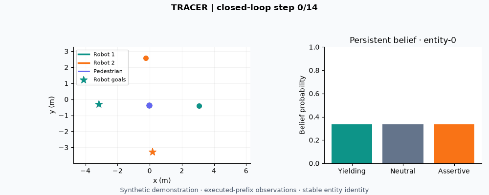

# TRACER

**TRACER 预测周围实体对联合机器人动作的响应，执行短时计划后，用实际观察更新身份绑定的持续信念，再进行下一轮规划。**

[English](README.md) · [论文](https://arxiv.org/abs/2609.18776) · [实验说明](docs/reproduction.md) · [模型](docs/models.md) · [结果](results/README.md)

## 快速开始

推荐 Python 3.12。按[安装说明](docs/installation.md)建立环境，在仓库根目录运行：

```bash
python -m pip install -e ".[dev]"
python -m tracer.demo --output outputs/demo
```

示例使用生成数据训练一个小型响应模型，执行七个决策窗口，展示机器人轨迹与持续信念的更新。输出动画、演示模型和决策记录。



示例的输入与输出说明见[演示指南](docs/demo.md)。

## 模型与结果

提供轻量的合成演示检查点；正式导航模型的资产状态见下载说明。

```bash
python tools/download_models.py
```

下载完成后自动校验文件。[模型说明](docs/models.md)给出模型身份与使用方式。[14 份精选结果](results/README.md)按实验协议组织；数据准备、训练和评估命令见[实验指南](docs/reproduction.md)。

## 开发检查

```bash
python tools/check_repository.py
python -m pytest -q
```

Linux 与 Windows 均运行 CPU 检查。依赖归档实验资产或 CUDA 的测试会明确报告跳过原因。

## 引用

使用 TRACER 开展研究时，请引用[论文](https://arxiv.org/abs/2609.18776)。[BibTeX](docs/citation.bib) · [CITATION.cff](CITATION.cff)。
